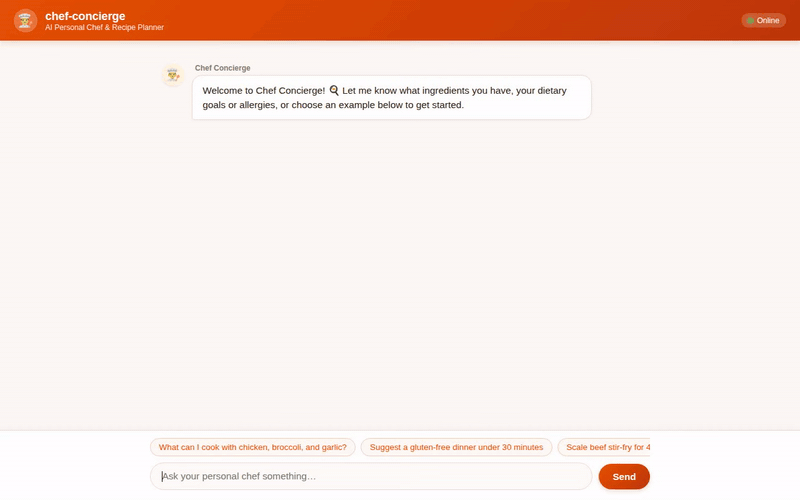

# 👨‍🍳 Chef Concierge

> **An agentic culinary assistant and personal chef built with Google ADK, Gemini, and Google Cloud Agent Platform.**
> Plan meals, match recipes against ingredients in your pantry, scale ingredient portions, compute nutrition macros, discover global cuisine, and generate photorealistic plating visuals — all while maintaining cross-session memory for strict food safety and allergy protection.

<div align="center">



</div>

---

## 🌟 Overview

**Chef Concierge** is an AI-powered personal chef and culinary assistant designed to take the friction out of everyday cooking. Instead of generic recipe lookups, Chef Concierge combines long-term user memory, database persistence, external culinary APIs, visual media generation, and secure code execution into a single unified agentic workflow.

Whether you need to know what you can cook with the items sitting in your fridge, need to scale a recipe for a dinner party, want to see what a dish looks like before cooking, or need to find a local grocery store for missing ingredients, Chef Concierge handles the entire journey.

---

## ✨ Core Capabilities (Implemented in Code)

Every capability listed below is wired into the agent's tools (`app/tools.py`), agent definition (`app/agent.py`), and deployment manifest (`agents-cli-manifest.yaml`):

### 🛡️ Allergy Safety & Cross-Session Memory
- **Allergy-Aware Preloading**: Built with a custom `AllergyAwarePreloadMemoryTool` that proactively queries the **Vertex AI Memory Bank** for known food allergies, ingredient intolerances, and dietary restrictions at the start of every turn.
- **Safety Prompt Injection**: Automatically injects permanent allergy warnings into model instructions before response generation, ensuring forbidden ingredients are strictly excluded from suggestions.
- **Automatic Session Learning**: Persists user dietary preferences, favorite cuisines, and household equipment across sessions via `after_agent_callback` and `add_session_to_memory()`.

### 🥫 Pantry Ingredient Matching
- **`find_recipes_by_pantry`**: Evaluates ingredients currently on hand in the user's kitchen against the Firestore recipe catalog.
- **Match Scoring**: Calculates ingredient match percentages and explicitly identifies which ingredients are available and which are missing.

### 📖 Firestore Recipe Catalog
- **`search_recipes`**: Searches and filters recipes stored in Google Cloud Firestore by keyword, cuisine, dietary tags (`keto`, `vegan`, `low-carb`, `gluten-free`, `pescatarian`), or maximum cooking time.
- **`get_recipe`**: Fetches complete recipe profiles including prep/cook times, difficulty, ingredient lists, step-by-step cooking instructions, and nutritional information (calories, protein, carbs, fat).
- **`save_recipe`**: Allows the agent to create and persist newly designed or customized recipes directly to Firestore with unique document slugs and complete nutritional metadata.

### 🌍 Global Recipe Discovery (TheMealDB)
- **`search_online_recipes`**: Integrates with the free global public TheMealDB API to fetch live international recipes, regional specialties (e.g. Italian, Thai, Indian), and random meal inspiration beyond the local database.

### 📸 Dish Photography & Culinary Video Generation
- **`generate_dish_image`**: Generates high-resolution, photorealistic food presentation imagery using **`gemini-3.1-flash-lite-image`** on Vertex AI (global region).
- **`generate_dish_video`**: Generates 5-second cinematic food presentation videos with appetizing motion (steam, sizzle, garnish) using Google's Omni model (**`gemini-omni-flash-preview`**) on Vertex AI.
- **Direct Cloud Storage Upload**: Automatically uploads generated media bytes directly to a public Google Cloud Storage bucket in memory (no temporary disk clutter) and attaches them as ADK session artifacts.

### 📍 Local Grocery Sourcing (Google Maps & Places)
- **`geocode_address`**: Converts street addresses or neighborhood names into geographic latitude and longitude coordinates.
- **`find_nearby_places`**: Uses the Google Places API (New) to locate nearby supermarkets, grocery stores, bakeries, or specialty markets within a designated radius when a recipe has missing ingredients.

### 🧮 Precision Culinary Math (Code Sandbox)
- **`AgentEngineSandboxCodeExecutor`**: Integrates with a secure Vertex AI Agent Engine Python sandbox environment.
- Safely executes Python code on demand to calculate dynamic ingredient portion scaling based on guest headcount and compute macronutrient totals.

### 🪟 Rich UI Rendering (A2UI)
- Integrated with `a2ui.basic_catalog` (v0.8) and `A2uiSchemaManager`.
- Emits structured A2UI cards (Card, Column, Row, Text, and GCS Image components) via `after_model_callback` for native card rendering in both the ADK dev UI and custom web chat frontends.

---

## 🏗️ Architecture & Google Cloud Services

Chef Concierge brings together the following Google Cloud and Gemini platform components:

```text
┌────────────────────────────────────────────────────────────────────────┐
│                          FastAPI Web Frontend                          │
│                (A2A Protocol Proxy + Built-in A2UI Renderer)           │
└───────────────────────────────────┬────────────────────────────────────┘
                                    │ (A2A Protocol)
                                    ▼
┌────────────────────────────────────────────────────────────────────────┐
│                        Google ADK Agent Runtime                        │
│                   Root Agent (gemini-3.8-flash)                        │
└─────┬──────────────┬──────────────┬──────────────┬──────────────┬──────┘
      │              │              │              │              │
      ▼              ▼              ▼              ▼              ▼
┌───────────┐ ┌────────────┐ ┌────────────┐ ┌────────────┐ ┌────────────┐
│ Vertex AI │ │   Google   │ │   Google   │ │ Vertex AI  │ │ Vertex AI  │
│  Memory   │ │   Cloud    │ │   Cloud    │ │    Code    │ │  GenAI /   │
│   Bank    │ │ Firestore  │ │  Storage   │ │  Sandbox   │ │    Omni    │
│ (Allergy  │ │  (Recipe   │ │ (Dishes &  │ │  (Portion  │ │  (Images   │
│  Memory)  │ │  Catalog)  │ │   Media)   │ │  Scaling)  │ │  & Video)  │
└───────────┘ └────────────┘ └────────────┘ └────────────┘ └────────────┘
```

| Service / Tool | Model / SDK | Purpose in Project |
|---|---|---|
| **Core Reasoning Agent** | `gemini-3.8-flash` | Main ADK agent orchestrating intent, memory retrieval, and tool execution |
| **Agent Framework** | `google-adk` + `agents-cli` | Agent definition, lifecycle callbacks, and A2A Protocol support |
| **Long-Term Memory** | Vertex AI Memory Bank | Cross-session memory for user preferences, kitchen equipment, and allergy preloading |
| **Code Execution Sandbox**| Vertex AI Agent Engine Sandbox | Isolated Python environment for ingredient scaling and macronutrient math |
| **Structured Data** | Google Cloud Firestore | NoSQL storage for recipe documents, instructions, and dietary tags |
| **Media Storage** | Google Cloud Storage (GCS) | Cloud bucket for hosting generated dish images and presentation videos |
| **Image Generation** | `gemini-3.1-flash-lite-image` | High-quality food photography and plated dish visuals |
| **Video Generation** | `gemini-omni-flash-preview` | Cinematic 5-second culinary video clips with steam and motion |
| **Agent-to-UI** | `a2ui-agent-sdk` (v0.8) | Emits structured JSON cards for visual rendering in the chat UI |
| **Location Services** | Google Maps Geocoding & Places APIs | Resolves coordinates and finds nearby supermarkets for missing ingredients |
| **External Recipes** | TheMealDB REST API | Global recipe search and culinary inspiration |

---

## 📋 Implementation Status

To ensure full transparency between the initial planning brief (`project_brief.md`) and the repository's code:

### ✅ Implemented & Verified
- [x] Memory Bank integration with automatic allergy preloading and cross-session persistence
- [x] Firestore recipe catalog search, detail retrieval, and custom recipe persistence
- [x] Pantry ingredient matching with match percentage and missing ingredient calculations
- [x] Vertex AI `gemini-3.1-flash-lite-image` photorealistic image generation
- [x] Vertex AI `gemini-omni-flash-preview` video generation
- [x] Direct-to-GCS in-memory media upload with public HTTPS URLs
- [x] Agent Engine Sandbox code executor for ingredient portion scaling and nutrition math
- [x] A2UI card formatting with `a2ui_callback`
- [x] Google Maps Geocoding & Places API integration for nearby grocery shopping
- [x] TheMealDB public API integration for world recipe exploration
- [x] A2A protocol support and FastAPI frontend proxy

### ⏳ Planned, Not Yet Implemented
- [ ] Dedicated Firestore collections for persistent shopping lists and pantry stock inventories *(pantry matching currently runs dynamically against the recipe catalog)*.
- [ ] Historical daily meal logging and tracking database.
- [ ] Interactive A2UI input forms and action buttons *(A2UI in ADK is currently display-only)*.

---

## 📁 Repository Structure

```text
.
├── assets/
│   ├── chef_concierge_demo.gif  # Optimized looping demonstration GIF
│   └── build-with-gemini-banner.png
├── chef-concierge/
│   ├── agents-cli-manifest.yaml # Agent manifest & deployment configuration
│   ├── pyproject.toml           # Project dependencies managed via uv
│   ├── Dockerfile               # Container definition for agent runtime
│   ├── GEMINI.md                # Agent instructions and development context
│   ├── app/
│   │   ├── __init__.py
│   │   ├── agent.py             # Agent definition, callbacks, and memory tools
│   │   ├── tools.py             # Firestore, GCS, Gemini image/video, & Maps tools
│   │   ├── a2ui_utils.py        # A2UI callback and card formatting utilities
│   │   ├── fast_api_app.py      # Backend FastAPI application
│   │   └── app_utils/           # A2A protocol and reasoning engine adapters
│   ├── frontend/
│   │   ├── main.py              # FastAPI frontend proxy for chat and A2UI rendering
│   │   ├── requirements.txt
│   │   └── static/              # Chat UI styles, script, and A2UI renderer
│   └── scripts/
│       └── seed_firestore.py    # Seed script for initial curated recipes
├── project_brief.md             # Original project brief and tool coverage plan
└── README.md                    # Project documentation
```

---

## 🚀 Setup & Local Run Instructions

Follow these instructions to run the agent and frontend on your local workstation.

### Prerequisites

1. **Python 3.11+** and **[uv](https://docs.astral.sh/uv/)** installed.
2. **Google Cloud SDK (`gcloud`)** installed and authenticated:
   ```bash
   gcloud auth login
   gcloud auth application-default login
   gcloud config set project <YOUR_GCP_PROJECT_ID>
   ```
3. **agents-cli** installed:
   ```bash
   uv tool install google-agents-cli
   ```

### 1. Environment Configuration

In this directory, configure your environment variables:

```bash
cp .env.example .env
```

Ensure `.env` contains:
```ini
GOOGLE_GENAI_USE_VERTEXAI=true
GOOGLE_CLOUD_PROJECT=<YOUR_GCP_PROJECT_ID>
GOOGLE_CLOUD_LOCATION=us-east1
GOOGLE_MAPS_API_KEY=<YOUR_GOOGLE_MAPS_API_KEY>   # Optional: for geocoding & nearby stores
```

### 2. Seed the Recipe Catalog (Optional)

To populate Firestore with initial curated recipes (garlic butter salmon, keto chicken bowls, mushroom risotto, etc.):

```bash
uv run python scripts/seed_firestore.py
```

### 3. Run the Agent Backend

Start the ADK development playground with hot-reload:

```bash
agents-cli playground
```

*The playground starts the local agent service on your workstation.*

Alternatively, to run the A2A-compliant FastAPI backend:

```bash
uv run uvicorn app.fast_api_app:app --host 0.0.0.0 --port 8000 --reload
```

### 4. Run the Web Frontend

To launch the web chat interface with native A2UI card rendering:

```bash
cd frontend
uv pip install -r requirements.txt
uv run python main.py
```

*Open your browser to the local frontend port shown in the terminal output to start chatting with Chef Concierge.*

---

## 📄 License & Attribution

Built as part of the **Build with Gemini World Tour** (Track 3: Agent-First Applications).
Demonstration project developed with Google ADK, agents-cli, and Google Cloud Agent Platform.
